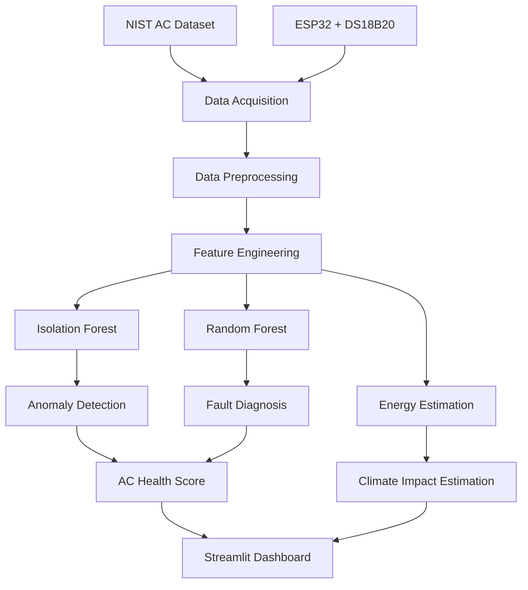
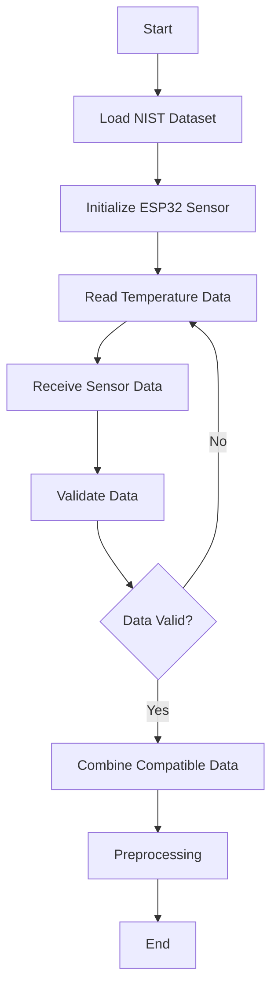
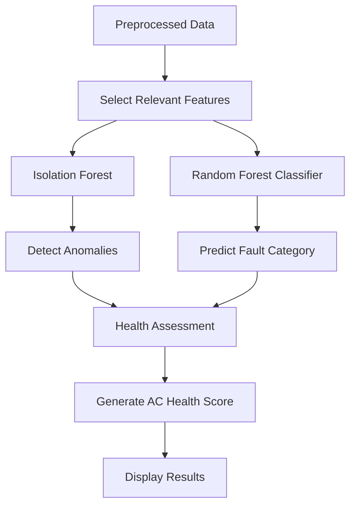
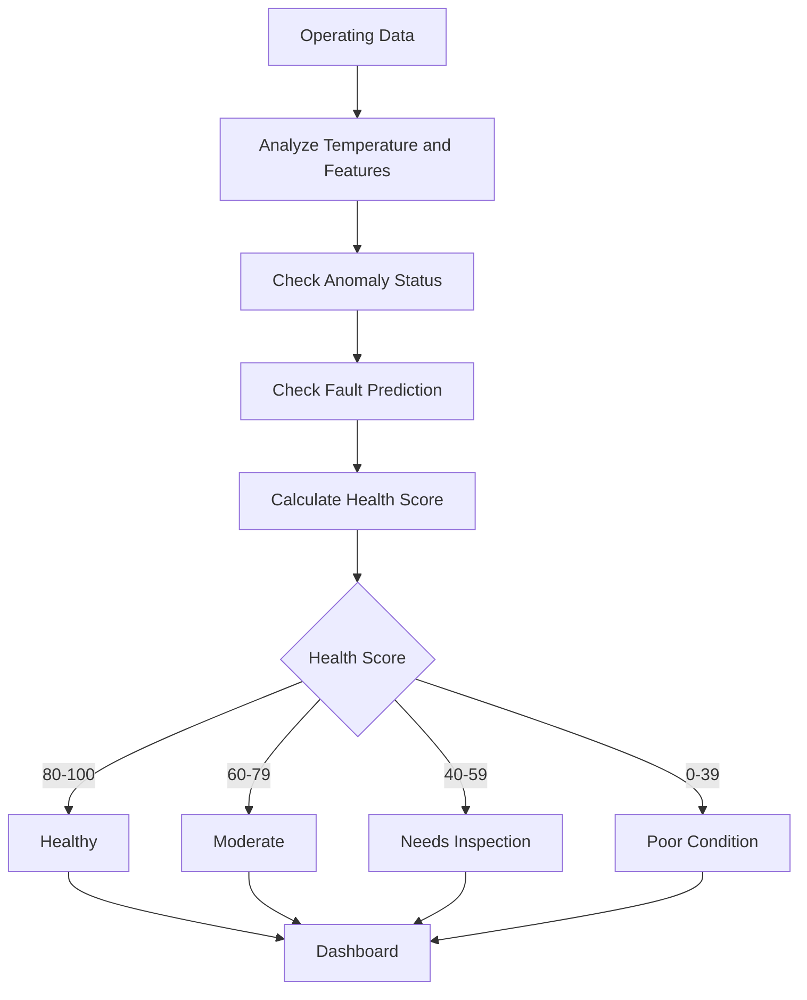
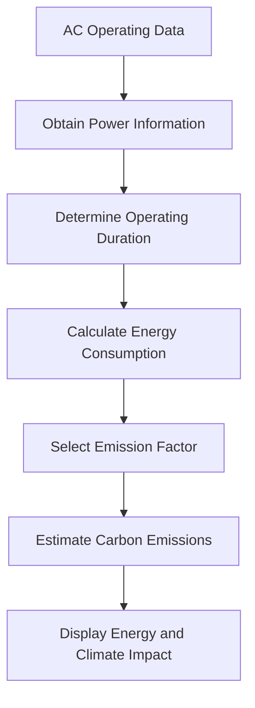

# System Design

## 1. System Overview

AI-AC-Health-Monitor is designed as a modular Machine Learning and IoT system.

The architecture consists of:

1. Data acquisition.
2. Data preprocessing.
3. Machine Learning analysis.
4. AC health assessment.
5. Energy and climate impact estimation.
6. Dashboard visualization.

The system supports dataset-based analysis and sensor-based monitoring.

## 2. Overall System Architecture

## 3. Data Acquisition Flowchart

This flowchart describes how operating data enters the software.

The dataset provides initial model development data, while ESP32 provides physical sensor measurements.

Sensor data will only be combined with model features when the measurements are compatible in units, meaning, and operating conditions.

## 4. Machine Learning Processing Flowchart

This flowchart represents the core analytical process.

### Isolation Forest

Isolation Forest identifies unusual operating patterns without requiring fault labels.

### Random Forest

Random Forest predicts fault categories using labeled training data.

The fault diagnosis model depends on the availability of suitable fault labels.

## 5. AC Health Assessment Flowchart

The health score is a project-defined indicator based on available operating parameters.

## 6. Energy and Climate Impact Flowchart

Energy consumption:

Energy (kWh) = Power (kW) × Operating Time (hours)

Carbon emissions:

Carbon Emissions (kg CO₂e) = Energy (kWh) × Emission Factor

If power is estimated rather than measured, the dashboard will identify the result as an estimate.

## 7. Hardware Architecture

The hardware subsystem collects temperature measurements and communicates them to the software.

### Hardware Components

- ESP32 development board.
- DS18B20 temperature sensor.
- Breadboard.
- Jumper wires.
- USB cable.

The initial hardware implementation focuses on temperature monitoring and software integration.

## 8. Software Module Design

| Module | Responsibility |
|---|---|
| data_preprocessing.py | Data cleaning and preparation |
| anomaly_detection.py | Isolation Forest implementation |
| fault_diagnosis.py | Random Forest classification |
| health_score.py | Health score calculation |
| climate_impact.py | Energy and emissions estimation |
| app.py | Dashboard interface |
| esp32_sensor_code.ino | ESP32 sensor acquisition |

## 9. Dashboard Design

The Streamlit dashboard will contain the following sections:

### Overview

- AC health score.
- Operating condition.
- Anomaly status.
- Predicted fault.

### Temperature Monitoring

- Sensor temperature.
- Temperature trend.
- Operating condition visualization.

### Fault Analysis

- Anomaly detection results.
- Predicted fault category.
- Relevant operating parameters.

### Energy Analysis

- Energy consumption.
- Operating duration.
- Energy-related trends.

### Climate Impact

- Estimated carbon emissions.
- Environmental impact indicators.

## 10. Model Evaluation

The Machine Learning models will be evaluated using suitable metrics.

### Anomaly Detection

- Detection behavior.
- False positives.
- False negatives.
- Comparison with available fault labels, where appropriate.

### Fault Diagnosis

- Accuracy.
- Precision.
- Recall.
- F1-score.
- Confusion matrix.

Model evaluation will use separate training and testing data.

## 11. Design Principles

- Modular and maintainable implementation.
- Separation of hardware and software components.
- Reusable data preprocessing.
- Efficient model loading.
- Clear separation between actual measurements and estimated values.
- Reliable sensor data validation.
- Simple and explainable dashboard outputs.

## 12. Future Enhancements

- Additional AC sensors.
- Real-time alerts.
- Cloud-based monitoring.
- Multiple AC support.
- Predictive maintenance recommendations.
- Improved energy estimation.
